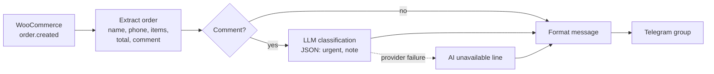

# WooCommerce Smart Order

<p align="center">
  
</p>

[](https://github.com/MaksymK-web-dev/woocommerce-smart-order/actions/workflows/ci.yml)
[](LICENSE)
[](composer.json)
[](wp-content/plugins/woocommerce-smart-order/woocommerce-smart-order.php)

A new WooCommerce order is inspected for delivery-time requests hidden in the free-form
customer comment, and the manager's Telegram group gets a message that says whether
anything needs attention.

Two interchangeable implementations ship here — the same logic once as a PHP plugin and
once as an n8n workflow — because the interesting part is the pipeline, not the tool.
In the deployment these screenshots come from, **n8n is the chain that runs**; the plugin
provides the settings screen and can take over by flipping one checkbox.



## The problem

Order comments carry two different kinds of text:

- `Подарункове пакування, якщо можливо` — a fulfilment detail.
- `Доставка після 18:00, зателефонувати за годину` — a delivery commitment that must
  reach a human before dispatch.

Read quickly, both look the same. The pipeline separates them, and it never lets a failed
classification look like a clean comment.

## Implementation 1 — WordPress plugin

`wp-content/plugins/woocommerce-smart-order/` — PHP 8.1+, `strict_types`, PSR-4 without a
Composer runtime dependency (the plugin has to run where `composer install` never ran).

```
woocommerce-smart-order.php   header + bootstrap, no logic
autoload.php                  PSR-4 loader for WSO\SmartOrder\
src/Plugin.php                composition root
src/Contract/                 Classifier, Notifier, HookRegistrar
src/Order/                    OrderPayload (readonly DTO), PayloadFactory, Pipeline
src/Ai/                       UrgencyResult, Prompt, ResponseParser, OpenAI + Anthropic adapters
src/Notify/                   Telegram, Log, factory
src/Hook/OrderListener.php    `woocommerce_new_order`
src/Admin/SettingsPage.php    Settings API screen under WooCommerce
src/Cli/TestOrderCommand.php  `wp smart-order test "..."`
src/Support/                  Logger, MessageFormatter
```

Design decisions worth naming:

- **Providers behind an interface.** `Classifier` has OpenAI and Anthropic adapters;
  switching provider is a setting, not a code change.
- **Three-state result, not two.** `UrgencyResult` distinguishes *not urgent* from
  *could not classify*. A manager must never mistake a failed API call for a clean comment.
- **Typed DTO at the boundary.** Everything after `PayloadFactory` works with
  `OrderPayload`, not `WC_Order` and not an array.
- **HPOS-safe.** Orders are read through `wc_get_order()` / `WC_Order` getters, never
  through the posts table.
- **Escaping at the edge.** Customer text is escaped before it enters Telegram's HTML mode,
  so a comment cannot break the message markup.

### The hook that fires too early

`woocommerce_new_order` fires inside the first `$order->save()` — before products,
addresses and the customer note exist. Reading the order there returns an empty object,
which is exactly what the first working version did: `No name (not provided)`,
`— — 0.00 UAH`. `OrderListener` therefore only collects ids and defers processing to
`shutdown`, when the order is complete and still in the same request.

### Configuration

Everything a shop manager needs lives at **WooCommerce → Smart Order**: enable, provider,
base URL, model, transport, group id, and the two credentials. Credentials can come from two
places:

1. **`wp-config.php` constants** — outside the database, outside git, wins over the screen:

```php
define( 'WSO_OPENAI_API_KEY', 'sk-...' );      // or WSO_ANTHROPIC_API_KEY
define( 'WSO_AI_API_KEY', 'AIza...' );        // Gemini and custom endpoints
define( 'WSO_TELEGRAM_BOT_TOKEN', '123:AA...' );
```

2. **The settings screen** — stored in the `wso_smart_order` option. Rotating a key is a
   form submit, not a deploy. The field never prints a stored value back: empty means
   *keep what is stored*.

Each secret shows where its effective value comes from (*not set* / *saved in the database* /
*set in wp-config.php — the stored value is ignored*), and **Test connection** proves it
before anything depends on it. The check is live but costs nothing: the provider's models
listing authenticates the key, and Telegram's `getMe` + `getChat` confirm the token and that
the bot can see the configured group. A key typed into the field is tested without saving
first.

### Any model, not one model

A provider is a base URL plus a model name, not a class:

- **OpenAI** — `https://api.openai.com/v1`
- **Google Gemini** — `https://generativelanguage.googleapis.com/v1beta/openai` (Gemini's
  own OpenAI-compatible endpoint)
- **Anthropic** — native messages API, kept separate because it does not speak `/chat/completions`
- **Custom endpoint** — any URL the customer runs: OpenRouter, Groq, DeepSeek, Mistral,
  vLLM, Ollama (`http://localhost:11434/v1`), LM Studio

The model field is free text, so `gpt-4o-mini`, `gemini-2.0-flash`, `llama3.2:3b` and
`deepseek-chat` all work without a code change. A model name carried over from another
provider would be rejected by the new one, so it is replaced by that provider's default.

Providers disagree about optional request parameters. When a provider rejects
`response_format` or `temperature`, the adapter drops that parameter and retries instead of
losing the notification, and it unwraps the `[{…}]` error envelope some gateways return so
the admin sees the provider's own wording.

A provider with a genuinely different protocol can be supplied from another plugin through
the `wso_smart_order_classifier` filter.

With transport set to *Log only* the pipeline is fully observable in
**WooCommerce → Status → Logs** (`woocommerce-smart-order` source) without any credentials —
that is the default, so a fresh install never fails silently.


### One chain per order

The plugin and the n8n workflow are two implementations of the same delivery. Both fire on
the same event, so running both means two messages per order. *Enable processing* is the
switch: it is **off** in this deployment because n8n delivers, and the plugin then does
nothing to the order. The settings screen also looks for active `order.created` webhooks
and warns, naming them, when both chains are live.

## Implementation 2 — n8n workflow

`n8n/workflow.json` (generated by `n8n/build-workflow.mjs`) runs the same four steps
visually: webhook → extract → LLM classification → Telegram.
`wp-content/mu-plugins/wso-local-webhook-transport.php` is the one local-only shim n8n
needs — see below.

The AI node takes its endpoint, key and model from the environment, so the same workflow
runs on OpenAI, Gemini, Groq, DeepSeek or a local server — the same "a provider is a base
URL plus a model" idea as the plugin:

```bash
# .env.example lists every variable; keep the filled copy outside the web root.
AI_BASE_URL=https://generativelanguage.googleapis.com/v1beta/openai
AI_API_KEY=AIza...
AI_MODEL=gemini-2.5-flash
```

```bash
docker run -d --name n8n -p 5678:5678 --env-file ~/.config/wso/n8n.env \
  -e N8N_SECURE_COOKIE=false -e N8N_BLOCK_ENV_ACCESS_IN_NODE=false \
  -v n8n_data:/home/node/.n8n n8nio/n8n:latest

docker cp n8n/workflow.json n8n:/tmp/wf.json
docker exec n8n n8n import:workflow --input=/tmp/wf.json
docker exec n8n n8n list:workflow                    # note the id
docker exec n8n n8n publish:workflow --id=<id>
docker restart n8n                                   # a running instance ignores the publish
```

### Two traps specific to a local n8n

**WooCommerce delivers webhooks asynchronously.** `woocommerce_deliver_webhook_async` is
queued through Action Scheduler and drained by WP-Cron or site traffic. On a local site
with neither, the action sits in `pending` and nothing is ever sent. `tools/wc-setup.php
order` drains the queue explicitly for that reason.

**`wp_safe_remote_post()` refuses the destination.** `wp_http_validate_url()` rejects
loopback/private hosts and ports outside `http_allowed_safe_ports` (80, 443, 8080), so
`127.0.0.1:5678` fails twice. The mu-plugin allows exactly that host + port + `/webhook/`
path and nothing else — the control case `http://127.0.0.1:9999/other` is still refused.
A hosted n8n needs none of it.

## Getting started

```bash
composer install                                    # dev tools: phpcs, phpunit

composer cs                                         # WordPress coding standards
composer test                                       # unit tests
composer check                                      # both
```

The plugin folder is meant to be dropped into `wp-content/plugins/` of a WordPress
install with WooCommerce active. The unit tests do not need WordPress: a small bootstrap
stubs the handful of global functions the covered classes touch.

## Repository layout

```
.github/workflows/ci.yml      lint 8.1–8.4, coding standards, tests, workflow JSON check
wp-content/plugins/woocommerce-smart-order/   the plugin
wp-content/mu-plugins/wso-local-webhook-transport.php   local n8n transport shim
n8n/workflow.json             importable workflow
n8n/build-workflow.mjs        workflow source (authored as JS, not clicked)
tools/wc-setup.php            CLI: webhook | order | deliver | cron | list
tests/                        PHPUnit unit tests
.env.example                  secrets n8n reads
```

The working tree doubles as the site's document root on the author's machine, so
`.gitignore` is deny-by-default and re-includes only the paths above.

## Verification status

Verified on a local WordPress 7.1.4 + WooCommerce 11.3.0 + PHP 8.4 install:

- plugin activates, HPOS compatibility declared, `php -l` clean on every file;
- **a real order reached a real Telegram group.** Order #47 (`Доставка після 18:00,
  зателефонувати за годину`) was classified by Gemini through the pipeline and delivered:
  `HTTP 200 ok=true message_id=15`, chat «Test Group». Order #48 (`Гарний сайт, дякую`)
  was delivered without the flag line, as *no urgent delivery request found*;
- classification runs in both directions against the live model: a delivery-time request
  is `urgent: true`, a compliment or a packaging note is `urgent: false`;
- 115 unit tests over the parser (fenced JSON, `{"urgent": "false"}`, prose, arrays,
  missing keys), the formatter (three branches, markup escaping, double-escaping), the
  prompt contract, per-provider key storage, the base-URL validator, key-prefix
  detection, the settings markup, and the credential checks (missing key, provider
  mismatch, provider error, transport failure, unreachable Telegram group);
- live checks in the browser: both *Test connection* buttons report the provider's own
  wording, and a Google key under the OpenAI provider is named as a mismatch instead of
  being sent;
- the settings form was driven through Chrome DevTools: saving a key-shaped value into
  the custom base-URL field is refused with a visible notice and nothing is stored;
- the duplicate-delivery warning fires on the settings screen for the real
  `order.created` webhook and stays silent on every other screen;
- coding standards clean under WordPress rules, adapted for PSR-4 as documented in
  `phpcs.xml.dist`;
- **the n8n chain ran end to end** against Gemini: order → Action Scheduler → webhook →
  extract → Gemini (`gemini-2.5-flash`, `finish_reason: stop`) → Telegram
  `ok: true`, `message_id: 20` in «Test Group». A comment with a delivery-time request
  produced «⚠️ ШІ-позначка», a compliment produced «✅ ШІ: термінових вимог щодо
  доставки не знайдено».

Not verified — stated rather than implied:

- no webhook signature is verified on the n8n path, so an unsigned POST would be accepted
  by the workflow.
- `tools/wc-setup.php deliver <id> --root=…` misreads the flag as a webhook id; use
  `WSO_WP_ROOT` for that command until it is fixed.

## Known gaps

- **No idempotency.** WooCommerce retries webhook delivery; the plugin listens to
  `woocommerce_new_order`, which in practice fires once, but a repeated admin request would
  notify twice.
- **No webhook signature verification** on the n8n path (`X-WC-Webhook-Signature`).
- **No retry policy** on Telegram failures; the failure is logged and the message is lost.
- **Synchronous LLM call** at `shutdown`: a slow provider delays the response. It belongs
  in an async job before high-traffic use.

## License

MIT — see [LICENSE](LICENSE). n8n itself is distributed under the Sustainable Use License:
self-hosting for internal use is fine, reselling it as a service is not.
